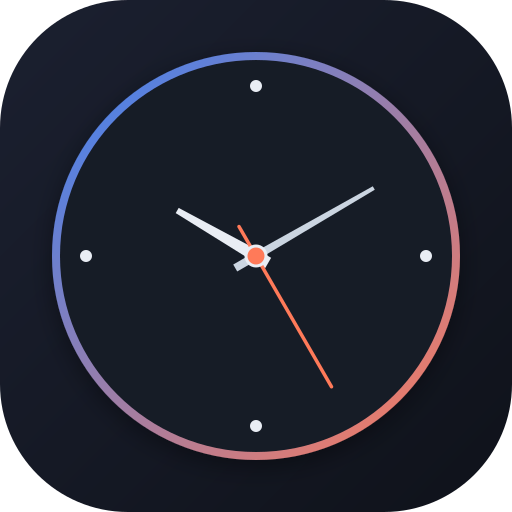

# World Clock & Precision Time

A modern, responsive, mobile-first World Clock application built with React 19, Vite, and Capacitor for Android.



## New Features

- 🖥️ **Fullscreen StandBy / Desk Clock Mode**:
  - Immersive full-screen nightstand/desk mode with native Fullscreen API and Capacitor status bar hiding.
  - **Screen WakeLock API**: Prevents the screen from turning off while docked on a charging stand or bedside table.
  - **Dual Display & Minimalist Modes**: Toggle between combined Analog + Digital or ultra-large minimalist digital clock.
  - **Nightstand Dim Mode**: Soft brightness reduction for dark rooms.
  - Auto-hiding control buttons with tap-to-reveal.
  - Full landscape and portrait responsiveness.
- 🌡️ **Live Temperature & Weather Conditions**:
  - Live local weather powered by Open-Meteo with 20-minute local caching.
  - Dynamic weather condition icons (Sunny, Clear night, Partly Cloudy, Rain, Thunderstorm, Snow, Fog).
  - One-tap toggle between **Celsius (°C)** and **Fahrenheit (°F)**.
  - City-level temperatures displayed directly on world clock cards!
- 📅 **Prominent Date & Weekday Display**:
  - High-visibility Weekday badge (`SATURDAY`, `SUNDAY`, etc.) and full Calendar Date (`24 October 2026`).
  - **Luxury Watch Day-Date Aperture**: Beveled aperture window at 3 o'clock on the analog dial displaying authentic `[ SAT | 24 ]`.
  - Local weekday and date shown for each monitored world city.
- ⏱ **Precision Analog Clock**: Fluid vector SVG rendering with smooth sweep or discrete second ticking.
- 📱 **Mobile First & Responsive**: Optimized for phones and tablets with safe-area insets, mobile bottom navigation, and touch-optimized cards.
- 🌍 **Multi-City World Clocks**: Track up to 6 time zones simultaneously with relative day/hour differences (`+4h`, `-5h`, `Tomorrow`, `Yesterday`) and automatic daytime/nighttime sun/moon indicators.
- 🔍 **Interactive Timezone Search**: Search over 400+ IANA time zones or pick from popular global hubs with live time previews.
- 🎨 **6 Theme Presets & Customizer**:
  - Classic Light
  - Midnight Slate
  - AMOLED Black (battery saver for OLED screens)
  - Forest Emerald
  - Warm Sepia
  - Ocean Navy
  - Granular color picker for dial, markers, numerals, hands, and accent seconds hand.
- 🕒 **12h / 24h Modes**: Instant toggle between 12-hour AM/PM and 24-hour military digital formats.
- 🤖 **Android Native App (Capacitor)**: Built and packaged into installable Android APK with native status bar theming and back button handling.

## Development

```bash
# Install dependencies
npm install

# Start Vite dev server
npm run dev

# Build production web bundle
npm run build
```

## Android APK Build

```bash
# Sync web build to native Android
npx cap sync android

# Build debug APK using Gradle
cd android
./gradlew assembleDebug
```

Built APK is available at `release/clock-debug.apk` and `android/app/build/outputs/apk/debug/app-debug.apk`.

## License

MIT © [Qaisar Abbas](https://github.com/Kaiserabbas)
